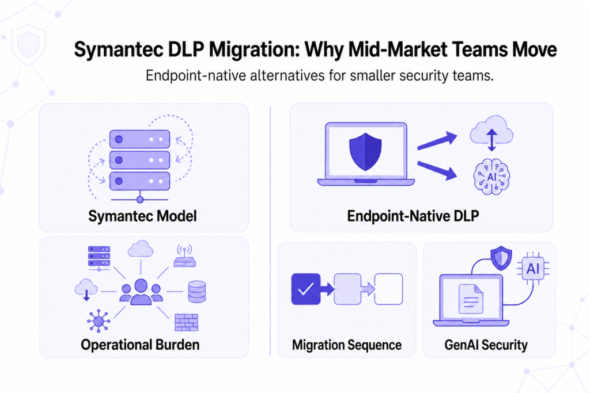

---
layout: post
title: "DLP for Mid-Market Security Teams Migrating from Symantec"
date: 2026-11-12 17:00:00 +0530
categories: Cybersecurity DLP
---

# DLP for Mid-Market Security Teams Migrating from Symantec

Symantec DLP by Broadcom provides enterprise-level data protection across endpoints, networks, email, and cloud, but its multiple servers, network appliances, and separate modules can make it difficult for mid-market companies with small security teams to manage. Alternatives include Kitecyber for endpoint protection and GenAI security, Safetica for endpoint DLP and insider-risk monitoring, Nightfall for SaaS and cloud applications, Cyberhaven for tracking data movement, Strac for SaaS, email, and GenAI protection, and Teramind for monitoring user activity. Modern [DLP solutions](https://www.kitecyber.com/product/data-loss-prevention-solution-vendor/) also help prevent sensitive information from being pasted or uploaded into AI tools such as ChatGPT and Claude. When migrating from Symantec DLP, companies should prioritize endpoint and removable-device protection first, followed by SaaS applications, email, browser uploads, and legacy network controls. Both systems should run in parallel during migration to verify detection accuracy and prevent security gaps. The final choice should depend on deployment complexity, data classification accuracy, GenAI protection, compliance requirements, and the team's available resources.

[Learn More](https://www.livejournal.com/away?to=https%3A%2F%2Fwww.kitecyber.com%2Fblog%2Fdlp-for-mid-market-security-teams-migrating-from-symantec%2F%3Futm_source%3Dchatgpt.com) about DLP solutions for mid-market security teams migrating from Symantec, including key considerations, migration challenges, and strategies for strengthening data protection.
