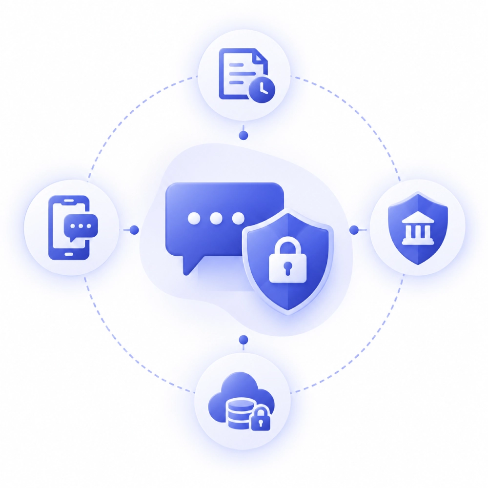

---
layout: post
title: "DLP for Financial Advisors: Meeting FINRA and SEC Recordkeeping Rules Without Slowing Down Client Communications"
date: 2026-11-12 22:00:00 +0530
categories: Cybersecurity DLP
---

# DLP for Financial Advisors: Meeting FINRA and SEC Recordkeeping Rules Without Slowing Down Client Communications

Financial advisors must comply with FINRA and SEC recordkeeping regulations, which require business communications to be captured, retained, supervised, and stored in compliant formats. However, advisors often communicate with clients through personal text messages, WhatsApp, and other unapproved channels that may not be connected to the firm's archiving systems. This creates gaps in recordkeeping and exposes financial firms to regulatory penalties. Endpoint-native [Data Loss Prevention (DLP)](https://www.kitecyber.com/product/data-loss-prevention-solution-vendor/) helps address this issue by monitoring communication activity directly on devices, identifying sensitive client information and business conversations, and detecting when they are about to be sent through unmonitored channels. Kitecyber uses its See, Decide, Enforce approach to identify potential risks, evaluate whether the communication follows company policy, and warn or block users from sending messages through unapproved channels. This helps financial firms keep regulated conversations on approved, archived platforms while complementing existing recordkeeping solutions. Endpoint DLP can also support broader data security and compliance efforts by providing visibility and control over sensitive information across devices, browsers, email, SaaS applications, and other communication tools.

[Learn More](https://www.livejournal.com/away?to=https%3A%2F%2Fwww.kitecyber.com%2Fblog%2Fdlp-financial-advisors-finra-sec-recordkeeping%2F%3Futm_source%3Dchatgpt.com) about Data Loss Prevention (DLP) for financial advisors, including FINRA and SEC recordkeeping requirements, key security features, and how to protect sensitive financial data while maintaining regulatory compliance.
