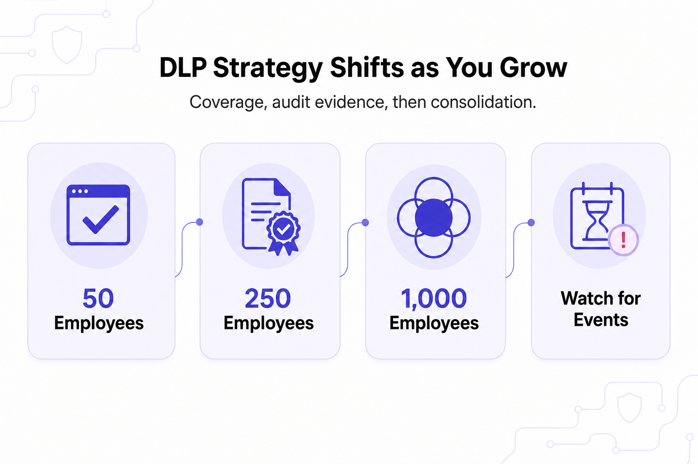

---
layout: post
title: "DLP at 50, 250, and 1,000 Employees: How the Right Answer Changes as You Grow"
date: 2026-11-12 19:00:00 +0530
categories: Cybersecurity DLP
---

# DLP at 50, 250, and 1,000 Employees: How the Right Answer Changes as You Grow

A company’s [Data Loss Prevention (DLP)](https://www.kitecyber.com/product/data-loss-prevention-solution-vendor/) strategy should evolve as it grows, because its security needs change at different stages. At around 50 employees, the priority is simple, automated protection that does not require a dedicated security team. At 250 employees, companies often face their first major compliance audits, so they need reliable logs, data tracking, and evidence that security policies are being enforced. At 1,000 employees, the main challenge becomes managing multiple security tools and ensuring consistent policies across devices, email, browsers, cloud applications, and AI tools. Companies should watch for signs such as new customer security requirements, additional compliance frameworks, and difficulty tracking data across different systems rather than relying only on headcount. The growing use of generative AI also increases the risk of sensitive information being shared without authorization. Kitecyber presents its endpoint-native DLP platform as a way to provide centralized, context-aware data protection, real-time enforcement, and broader security coverage through one agent.

[Learn More](https://www.livejournal.com/away?to=https%3A%2F%2Fwww.kitecyber.com%2Fblog%2Fdlp-for-different-company-sizes%2F%3Futm_source%3Dchatgpt.com) about how Data Loss Prevention (DLP) solutions vary by company size, including key features, security needs, and how to choose the right solution for your organization.
