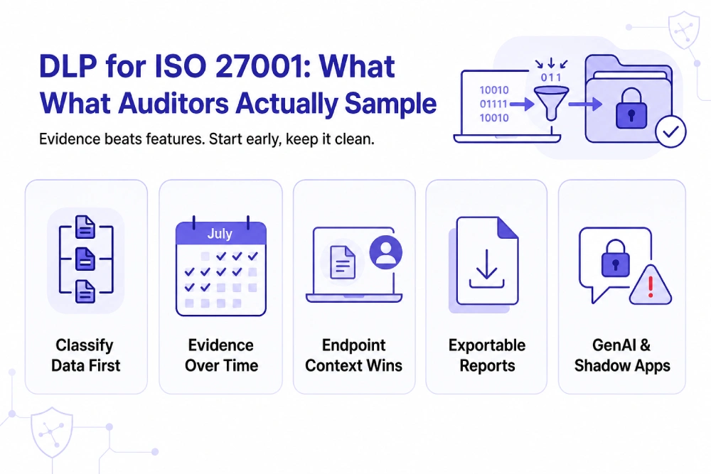

# Best DLP Tools for Mid-Market Companies Facing ISO 27001 Certification in 2026

[Data loss prevention (DLP)](https://www.kitecyber.com/product/data-loss-prevention-solution-vendor/) software helps organizations implement ISO 27001:2022 data protection requirements and generate evidence for audits. Annex A Control 8.12 specifically addresses data leakage prevention, supported by controls for data masking (A.8.11) and monitoring activities (A.8.16). For mid-market companies preparing for a Stage 2 audit, the priority is choosing a solution that consistently detects, logs, and blocks unauthorized data transfers while producing exportable audit evidence.

Unlike written policies, operational evidence includes incident logs, alerts, enforcement records, and remediation histories collected over time. DLP supports an organization's Information Security Management System (ISMS), but certification depends on the effectiveness of the overall security program. Endpoint-native solutions can provide detailed evidence identifying the user, device, file, destination, and action taken, helping auditors verify how sensitive data is protected.

Solutions worth evaluating include Kitecyber, Safetica, Cyberhaven, Microsoft Purview, Endpoint Protector, and Nightfall. Each offers different capabilities across endpoint protection, data classification, SaaS monitoring, and data lineage. The right choice depends on the organization's infrastructure, risk exposure, reporting needs, and budget. Companies should classify sensitive data, map policies to relevant ISO controls, test false positives, monitor GenAI usage, and enable evidence collection well before the audit. Kitecyber focuses on endpoint-native DLP across Windows, macOS, and Linux, with visibility into browser activity, email, clipboard, removable media, SaaS applications, and GenAI tools. Its continuous monitoring and enforcement capabilities can help organizations strengthen data protection and prepare for ISO 27001 certification.

[Learn More](https://www.livejournal.com/away?to=https%3A%2F%2Fwww.kitecyber.com%2Fblog%2Fdata-loss-prevention-software%2F%3Futm_source%3Dchatgpt.com) about Data Loss Prevention (DLP) software, including its key features, benefits, and how to choose the right solution to protect sensitive data and strengthen your organization's security.
