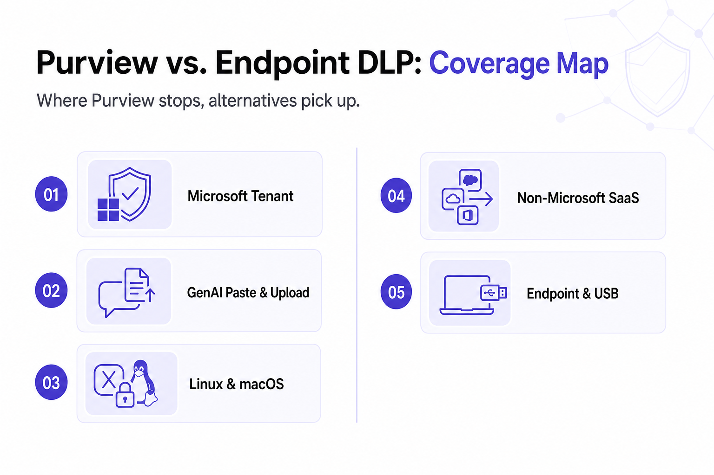

---
layout: post
title: "Best Microsoft Purview Alternatives for Mid-Market Companies Outside the E5 License"
date: 2026-11-12 14:00:00 +0530
categories: Cybersecurity DLP
---

# Best Microsoft Purview Alternatives for Mid-Market Companies Outside the E5 License

Mid-market companies using Microsoft 365 E3 or Business Premium may find that advanced Purview features, such as endpoint DLP and insider risk management, require E5 licensing or additional compliance add-ons. Rather than waiting for budget approval, teams can evaluate alternative [DLP solutions](https://www.kitecyber.com/product/data-loss-prevention-solution-vendor/) that protect data across endpoints, third-party SaaS applications, Linux devices, browsers, and GenAI tools like ChatGPT and Claude. Microsoft Purview remains effective for organizations operating primarily within Microsoft 365 and Azure, particularly for data classification, sensitivity labeling, and compliance management, but its coverage may be limited outside that ecosystem.

Alternatives include Kitecyber, Nightfall, Strac, Cyberhaven, and Safetica, each offering different approaches to data protection. Nightfall focuses on cloud and SaaS security, Strac combines endpoint and API-based protection, Cyberhaven emphasizes data lineage, and Safetica offers endpoint DLP and insider risk monitoring. Kitecyber focuses on endpoint-native DLP across Windows, macOS, and Linux, with controls for browser activity, removable media, SaaS applications, and GenAI usage. To choose the right solution, mid-market teams should identify where sensitive data moves, assess their compliance requirements, and compare enforcement capabilities, deployment complexity, and licensing costs. The goal is to close data protection gaps without unnecessary spending or operational overhead.

[Learn More](https://www.livejournal.com/away?to=https%3A%2F%2Fwww.kitecyber.com%2Fblog%2Fmicrosoft-purview-dlp-alternatives%2F%3Futm_source%3Dchatgpt.com) about the best Microsoft Purview DLP alternatives, including their key features, benefits, and how to choose the right Data Loss Prevention solution for your organization’s security and compliance needs.
