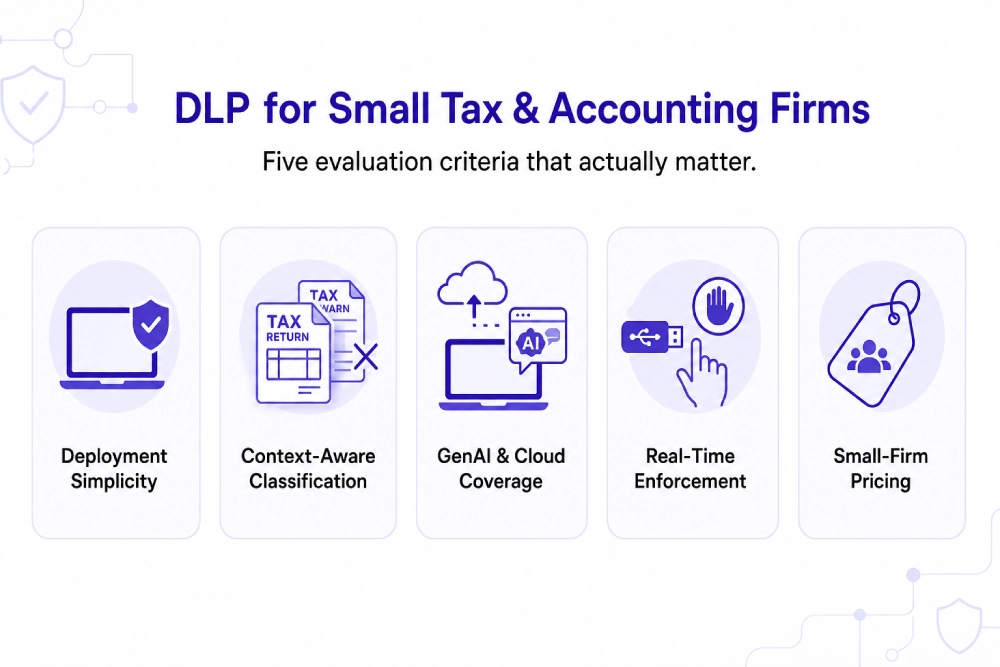

---
layout: post
title: "Best DLP Solutions for Small Accounting and Tax Firms Handling Client Financial Records"
date: 2026-11-12 15:00:00 +0530
categories: Cybersecurity DLP
---

# Best DLP Solutions for Small Accounting and Tax Firms Handling Client Financial Records

Small accounting and tax firms need [data loss prevention (DLP)](https://www.kitecyber.com/product/data-loss-prevention-solution-vendor/) software that protects sensitive client information, including tax returns, Social Security numbers, bank details, payroll records, and financial statements. Common risks include emails sent to the wrong recipients, client files saved to personal cloud storage, unsecured home devices, seasonal staff access, and sensitive information pasted into AI chatbots. The FTC Safeguards Rule and IRS Publication 4557 emphasize protecting taxpayer information through a Written Information Security Plan (WISP) and appropriate technical safeguards.

For firms with 10–200 employees and limited IT resources, endpoint-native DLP can help detect and prevent data leaks directly on employee devices. Important features include context-aware data classification, real-time enforcement, email and browser monitoring, removable media controls, cloud application coverage, and GenAI protection. Leading options include Kitecyber, Endpoint Protector, Safetica, Microsoft Purview, and Nightfall, each with different strengths in endpoint security, device control, and cloud protection. The best choice depends on the firm's existing infrastructure, budget, deployment complexity, and compliance requirements. Before selecting a solution, firms should evaluate false-positive rates, ease of management, and the quality of audit logs. Kitecyber focuses on endpoint-native protection across Windows, macOS, and Linux, helping firms monitor sensitive data movement across email, browsers, cloud storage, removable media, and GenAI tools.

[Learn More](https://www.livejournal.com/away?to=https%3A%2F%2Fwww.kitecyber.com%2Fblog%2Fpci-dss-compliance-software%2F%3Futm_source%3Dchatgpt.com) about PCI DSS compliance software, including its key features, benefits, and how the right solution can help businesses protect payment card data and meet security compliance requirements.
