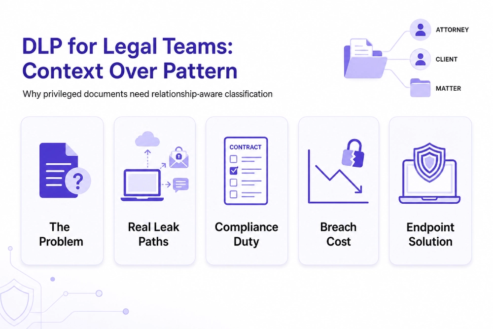

---
layout: post
title: "Best DLP Software for Regulated Teams Protecting Client Files and Privileged Documents"
date: 2026-11-12 18:00:00 +0530
categories: Cybersecurity DLP
---

# Best DLP Software for Regulated Teams Protecting Client Files and Privileged Documents

Small and mid-sized law firms need [Data Loss Prevention (DLP)](https://www.kitecyber.com/product/data-loss-prevention-solution-vendor/) software that protects confidential client information, legal documents, and privileged communications by understanding their context rather than relying only on pattern matching. Common data leak risks include sending emails to the wrong recipients, syncing case files to personal cloud accounts, giving external reviewers excessive access, and pasting sensitive client information into AI tools such as ChatGPT. These incidents can lead to financial losses, reputational damage, and breaches of professional confidentiality obligations. Available solutions include virtual data rooms for secure deal-specific document sharing, Microsoft Purview for firms using Microsoft 365, Endpoint Protector for USB and device control, Cyberhaven for tracking data movement, and Kitecyber for endpoint protection, context-aware classification, and GenAI security. The best solution depends on the firm's existing technology, security needs, and budget. For smaller firms without dedicated security staff, an easy-to-manage DLP solution that automatically detects and prevents unauthorized data transfers can reduce risk while helping maintain compliance with applicable requirements.

[Learn More](https://www.livejournal.com/away?to=https%3A%2F%2Fwww.kitecyber.com%2Fblog%2Fblog-best-dlp-software-for-regulated-teams%2F%3Futm_source%3Dchatgpt.com) about the best DLP software for regulated teams, including key features, compliance requirements, and how to choose the right solution to protect sensitive data.
