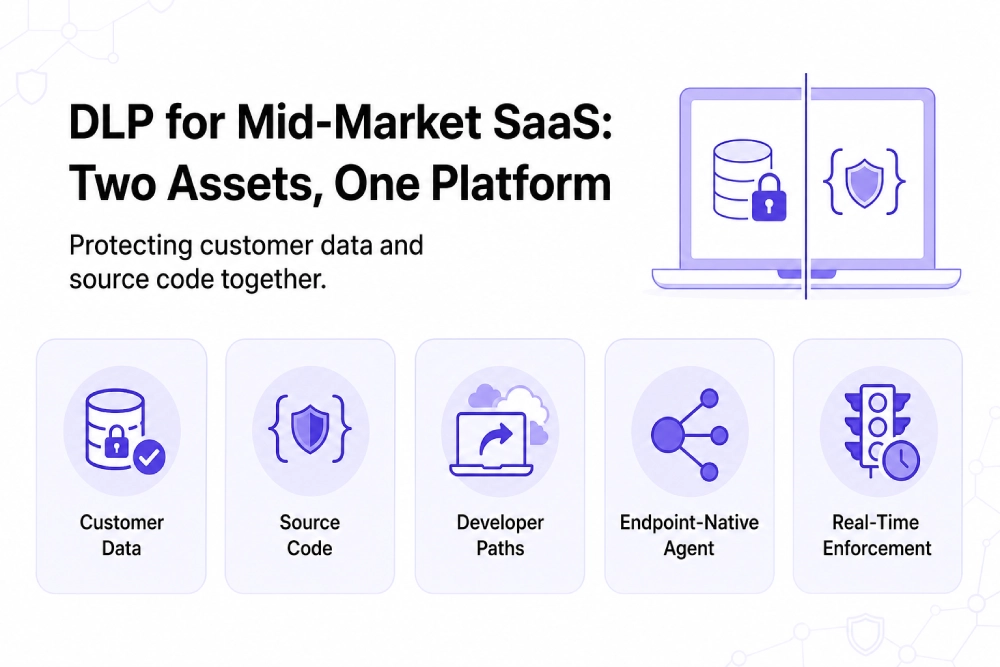

---
layout: post
title: "Best DLP Platforms for Mid-Market SaaS Companies Protecting Customer Data and Source Code"
date: 2026-11-12 21:00:00 +0530
categories: Cybersecurity DLP
---

# Best DLP Platforms for Mid-Market SaaS Companies Protecting Customer Data and Source Code

Mid-market SaaS companies need [DLP solutions](https://www.kitecyber.com/product/data-loss-prevention-solution-vendor/) that protect both sensitive customer data and proprietary source code. While customer data requires regulatory compliance and access controls, source code can leak through developer workflows such as personal devices, AI coding assistants, package registries, browser uploads, and support tickets. Traditional cloud-based DLP tools may miss these endpoint-level risks, making native Linux support, context-aware classification, GenAI monitoring, and real-time enforcement essential.

DLP gaps can also delay enterprise deals when customers assess security controls through SOC 2, ISO 27001, and vendor questionnaires. Leading options include Kitecyber, Cyberhaven, Nightfall, Endpoint Protector, Safetica, and Microsoft Purview, each offering different strengths in endpoint protection, data lineage, SaaS monitoring, or Microsoft integration. Kitecyber focuses on protecting customer data and source code across Windows, macOS, and Linux through a single agent that monitors files, clipboard activity, browsers, email, cloud apps, removable media, and GenAI tools. The best solution depends on the company's infrastructure and security priorities, and no platform can eliminate every possible source-code leak.

[Learn More](https://www.livejournal.com/away?to=https%3A%2F%2Fwww.kitecyber.com%2Fblog%2Fbest-dlp-platforms-mid-market-saas%2F%3Futm_source%3Dchatgpt.com) about the best DLP platforms for mid-market SaaS companies, including key features, benefits, and how to choose the right solution to protect sensitive data and strengthen cloud security.
