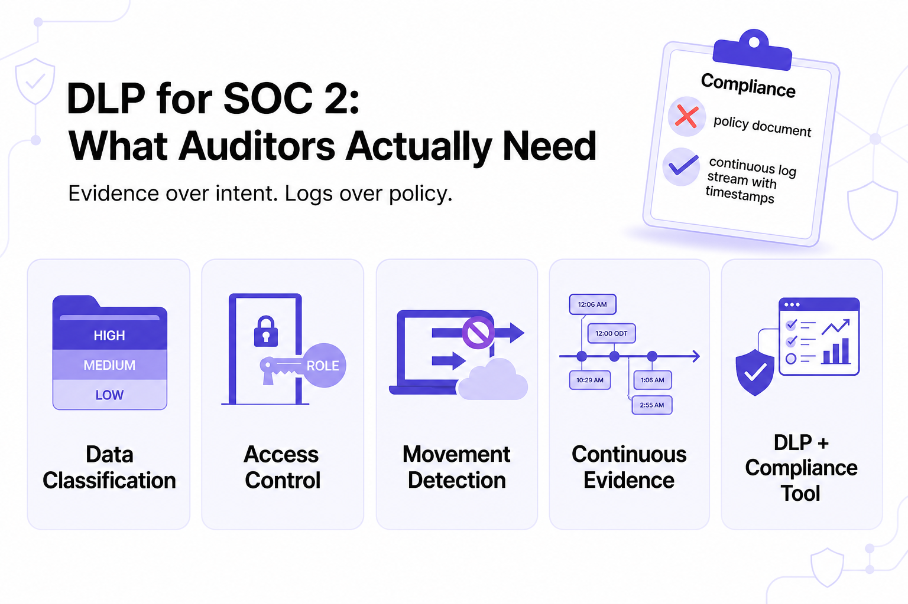

---
layout: post
title: "DLP for Your First SOC 2 Audit: What a 100-Person Company Actually Needs"
date: 2026-11-12 20:00:00 +0530
categories: Cybersecurity DLP
---

# DLP for Your First SOC 2 Audit: What a 100-Person Company Actually Needs

A 100-person company preparing for its first SOC 2 Type II audit needs a [Data Loss Prevention (DLP)](https://www.kitecyber.com/product/data-loss-prevention-solution-vendor/) solution that provides continuous, timestamped evidence of enforcement. DLP supports Security, Confidentiality, and Privacy controls by protecting sensitive data through classification, access restrictions, encryption, and monitoring unauthorized data movement. Auditors require consistent logs showing user activity, timestamps, and enforcement decisions rather than relying solely on written policies or screenshots. A practical 90-day implementation plan includes discovering sensitive data, designing classification policies, gradually enabling enforcement, and collecting audit evidence. Endpoint-native DLP monitors files, clipboard activity, browser uploads, email, USB devices, SaaS applications, and GenAI tools. While compliance platforms such as Vanta and Scrut manage compliance workflows and evidence, DLP actively detects, logs, and restricts risky data transfers. Kitecyber combines endpoint-native protection, context-aware classification, and continuous logging to help organizations strengthen data security and prepare for SOC 2 Type II audits.

[Learn More](https://www.livejournal.com/away?to=https%3A%2F%2Fwww.kitecyber.com%2Fblog%2Fdlp-for-your-first-soc-2-audit-what-a-100-person-company-actually-needs%2F%3Futm_source%3Dchatgpt.com) about preparing for your first SOC 2 audit, including essential Data Loss Prevention (DLP) requirements, key security controls, and practical steps for a 100-person company to protect sensitive data and meet compliance standards.
