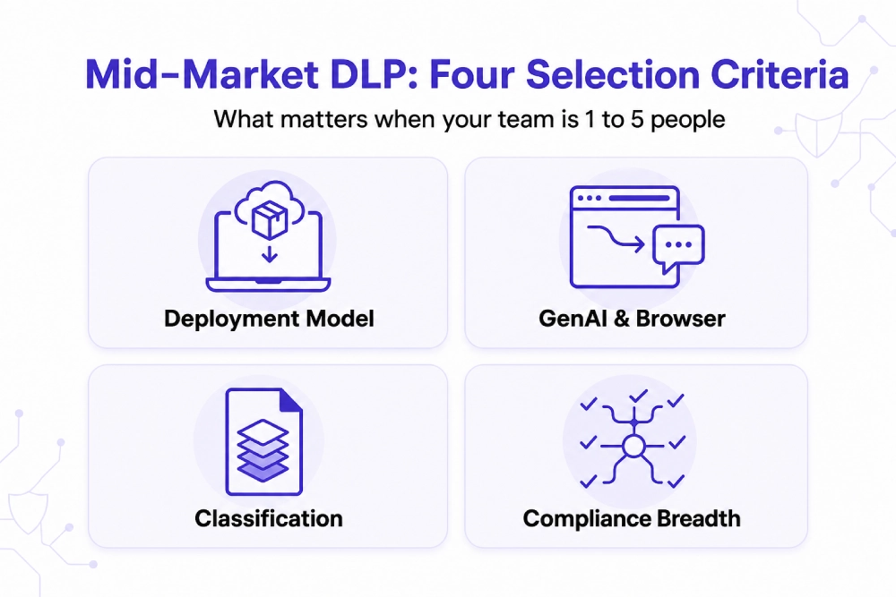

---
layout: post
title: "Best Data Loss Prevention Solutions for Mid-Market Companies in 2026: A Shortlist for 250 to 1,000 Employees"
date: 2026-11-12 16:00:00 +0530
categories: Cybersecurity DLP
---

# Best Data Loss Prevention Solutions for Mid-Market Companies in 2026: A Shortlist for 250 to 1,000 Employees

Companies with 250–1,000 employees need [Data Loss Prevention (DLP)](https://www.kitecyber.com/product/data-loss-prevention-solution-vendor/) software that protects sensitive information without requiring a large security team or complex infrastructure. Seven platforms to consider are Kitecyber, Safetica, Nightfall, Cyberhaven, Endpoint Protector, Netwrix, and Forcepoint. Each has different strengths: Kitecyber focuses on endpoint protection and GenAI security, Safetica on endpoint and cloud protection, Nightfall on SaaS and AI applications, Cyberhaven on tracking data movement, Endpoint Protector on USB and removable devices, Netwrix on data governance and compliance, and Forcepoint on unified security policies across cloud, web, and endpoints. The four main factors to consider when choosing a solution are ease of deployment, protection against browser uploads and GenAI data leaks, accurate data classification, and compliance coverage. Ultimately, companies should select a solution that meets their security needs while remaining affordable and easy to manage with their existing staff.

[Learn More](https://www.livejournal.com/away?to=https%3A%2F%2Fwww.kitecyber.com%2Fblog%2Fbest-data-loss-prevention-solutions-mid-market%2F%3Futm_source%3Dchatgpt.com) about the best Data Loss Prevention (DLP) solutions for mid-market businesses, their key features, benefits, and how to choose the right solution to protect sensitive data.
