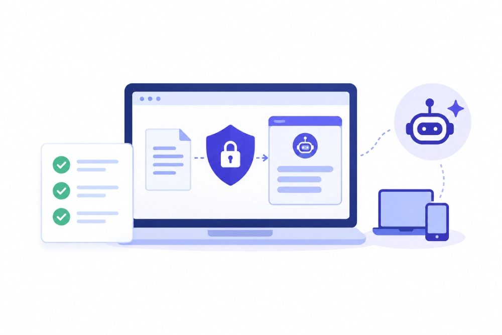

---
layout: post
title: "How to Evaluate a DLP Vendor's GenAI Security Claims: A Buyer's Checklist for 2026"
date: 2026-11-12 23:30:00 +0530
categories: Cybersecurity DLP
---

# How to Evaluate a DLP Vendor's GenAI Security Claims: A Buyer's Checklist for 2026

Organizations adopting generative AI tools must ensure that sensitive business information remains protected while employees use AI copilots, browser-based chatbots, and autonomous AI agents. Evaluating Data Loss Prevention (DLP) vendors requires more than checking whether they offer GenAI security features; businesses must assess their ability to detect sensitive information pasted into AI applications, monitor file uploads, identify unauthorized or shadow AI tools, and prevent data exfiltration in real time. A comprehensive [Data Loss Prevention (DLP) solution](https://www.kitecyber.com/product/data-security-solution/) with endpoint-level visibility and context-aware data classification helps organizations enforce consistent security policies across browsers, applications, endpoints, and AI-powered workflows. By monitoring user activity, controlling unauthorized data transfers, and maintaining visibility into autonomous AI agent actions, businesses can reduce data leakage risks, strengthen security governance, and protect confidential information without relying on disconnected security tools.

[Learn More](https://www.kitecyber.com/blog/how-to-evaluate-a-dlp-vendors-genai-security-claims-a-buyers-checklist-for-2026/) about evaluating DLP vendors' GenAI security claims, including shadow AI detection, context-aware classification, endpoint enforcement, autonomous AI agent protection, and the essential questions businesses should ask before choosing a DLP solution.
