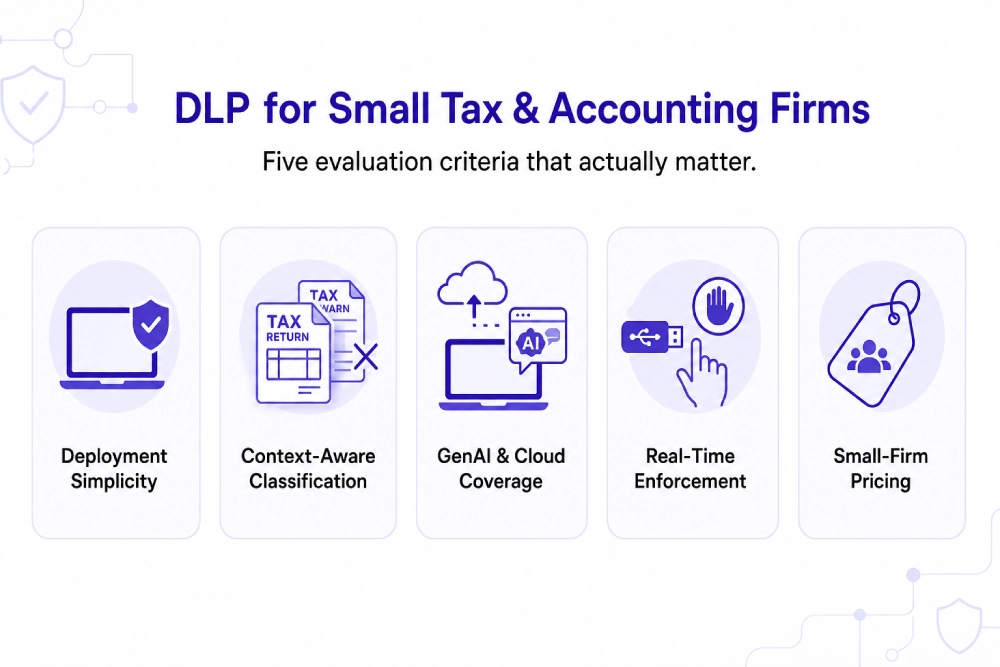

---
layout: post
title: "Best DLP Solutions for Small Accounting and Tax Firms Handling Client Financial Records"
date: 2026-11-13 10:00:00 +0530
categories: Cybersecurity DLP
---

# Best DLP Solutions for Small Accounting and Tax Firms Handling Client Financial Records

Organizations that process, store, or transmit payment card information must maintain strong security controls to protect sensitive cardholder data and meet PCI DSS compliance requirements. A comprehensive [Data Loss Prevention (DLP) solution](https://www.kitecyber.com/product/data-loss-prevention-solution-vendor/) helps businesses monitor and control how sensitive financial information moves across endpoints, emails, browsers, cloud storage, removable devices, and third-party applications. By identifying confidential payment information, detecting unauthorized data transfers, enforcing security policies in real time, and maintaining detailed audit trails, businesses can reduce the risk of data breaches and strengthen their overall security posture. Endpoint-native DLP also provides visibility into employee activity, prevents accidental data exposure, and helps organizations implement consistent data protection controls without relying on multiple disconnected security tools. These capabilities support compliance efforts by making it easier to demonstrate how sensitive information is discovered, monitored, and protected throughout the organization.

[Learn More](https://www.kitecyber.com/blog/pci-dss-compliance-software/) about PCI DSS compliance software, essential security requirements, data protection strategies, and how organizations can safeguard sensitive payment card information while strengthening regulatory compliance.
